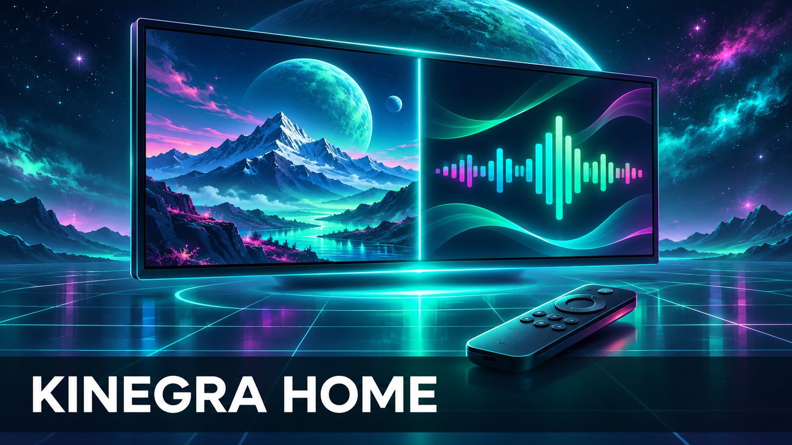
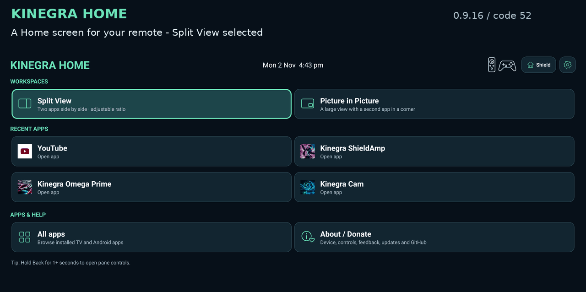

# Kinegra Home



**Built for ultrawide screens. Two apps. One remote.**

Kinegra Home is an Android TV launcher designed to make use of an ultrawide monitor’s extra screen space. Run two apps side by side on NVIDIA SHIELD: keep a browser beside a game or music player, adjust the split, and control the workspace with a TV remote.



## Install

Public beta: **0.9.25 / code 61**. Download the signed APK from the [Releases page](https://github.com/matthewhand/kinegra-home/releases). To install a signed release, use an Android TV sideloading tool, or:

```sh
adb connect DEVICE_IP:ADB_PORT
adb install -r KinegraHome-0.9.25.apk
```

Tested on the original NVIDIA SHIELD with **SHIELD Experience 9.x (Android 11)**. The dashboard supports Android 8.0+; two-app window support targets Android 11 on SHIELD. Keep app data and the same signing key when upgrading.

Two-app layouts need an owner-authorized local debugging helper. Enable the required developer settings and approve the app's connection once. [Setup and recovery](docs/SETUP.md).

## Use two apps

1. Open Home and choose **Split View** or **Picture in Picture**.
2. Choose two different installed apps. Labels read **Left app / Right app** or **Main app / PiP app**.
3. Select **Connect locally** if window support is disconnected, then **Launch**. Initial preparation briefly opens each app before returning to the canvas.
4. Use the pane controls to choose the active app, adjust the layout or swap positions.

Split View supports 20:80–80:20 ratios. A video-shaped layout reserves a full-height 16:9 pane when the display is wide enough. PiP uses a 20–40% inset in any corner. App-specific video borders may remain.

| Action | Shield remote | ASUS controller |
| --- | --- | --- |
| Choose a control | D-pad, OK | D-pad, A |
| Swap views | Back + OK | Back-arrow + Start |
| Open session controls | Hold Back | Hold Back-arrow |
| Send Back to the active app | Short Back | Short Back-arrow |

The ASUS controller’s Back-arrow button is called **Select** by Android.

Shortcuts while another app has focus require the optional **Kinegra Home session shortcuts** accessibility service. When the service is off, the app chooser and session menu show that Back-hold is unavailable and offer **Enable session shortcuts**. This opens Android settings for your choice. The service does not retrieve screen content or log accessibility events. **End layout** restores the selected tasks to fullscreen; **Home** opens the stock launcher.

If an app closes, an inline warning offers **Reload left/right app** or **Reload main/PiP app**. Reload restarts that package and may lose its unsaved state. Dismissed warnings stay dismissed until the failure changes or recovery completes.

## Beta scope

Split View is the main workflow. **PiP is experimental; some app pairs may show a blank pane.** Apps can impose their own orientation, minimum size, video and audio restrictions.

Development and testing use an ultrawide display. Layout checks also cover portrait and standard TV sizes; broader hardware and long-session coverage is limited.

See [compatibility and testing](docs/TESTING.md) and [privacy and local debugging](PRIVACY.md).

## Build and contribute

Use JDK 17, Android SDK Platform 34 and Build-Tools 34.0.0 on Linux. The source builds an unsigned APK without private assets, keys or another project checkout. [Build and signing instructions](BUILDING.md).

Bug reports should include the app/firmware versions, layout, steps and expected behavior. Remove account details and private addresses from attachments. [Issues](https://github.com/matthewhand/kinegra-home/issues).

[Current release scope and validation](docs/RELEASE.md).

## License

[MIT](LICENSE) covers original code, documentation and artwork. AdbLib, third-party marks and screenshot content retain their own terms; see [notices](THIRD-PARTY-NOTICES.md). Open the packaged licenses through **About / Donate → Open-source licenses**.
